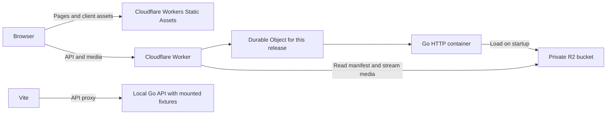

# Platform architecture

A visitor should be able to open a poem, browse a gallery, play a game, or share a project using a permanent URL. Billy publishes by reviewing and merging files in Git. Each release ties a writing snapshot, media manifest, API image, and frontend to one Git SHA. The [roadmap](roadmap.md) starts with one poem and carries it through production.

## Repository baseline

The first release implements the writing API and React writing routes. Photography, drawings, projects, and games follow the roadmap.

| Location | Responsibility |
| --- | --- |
| `app/client/` | React, TypeScript, Vite, page routes, Markdown rendering, accessible galleries, and lazy-loaded browser games. |
| `app/content/` | Published text, metadata, and web-sized media. Add `projects/` and `games/` when those sections ship. |
| `app/server/` | Go HTTP service, content validation, release export, health checks, and the API Dockerfile. |
| `deploy/cloudflare/` | A Worker, Durable Object binding, and Wrangler configuration. |
| `deploy/compose.yaml` | Run the API image with a mounted Git content directory. During editing, run Vite and Go directly. |
| `deploy/kubernetes/` | Local cluster manifests for the same application image. |
| `.github/workflows/` | Pull request checks, production release, and recovery workflow. |
| `.agents/skills/` | Repository-specific authoring or development skills when repeated tasks warrant one. |

## Request paths

**Pages and games.** Serve the Vite output through Workers Static Assets. A direct visit to `/writing/first-light` gets the React entry point. React loads the poem from the same origin. Reserve `/api/*` and `/media/*` with selective `run_worker_first` routing so the Worker handles them even during browser navigation. Enable single-page application fallback for client routes. [Cloudflare asset routing](https://developers.cloudflare.com/workers/static-assets/binding/)

**Content requests.** Use the Durable Object-managed scheduling policy. The Worker selects a named object keyed by the release SHA. Its first request starts the configured image, waits for the Go listener on port 8080, and forwards the request. Requests to that release reuse the instance until its idle timeout. A new SHA gets a fresh instance, which avoids reusing a running process with yesterday's content. Start with one instance per active release, measure cold-start time, and check the Workers Paid plan and usage costs before launch. [Cloudflare Containers guide](https://developers.cloudflare.com/containers/get-started/) · [Container pricing](https://developers.cloudflare.com/containers/platform/pricing/)

**Portable image.** Build the Linux AMD64 image from `app/server/Dockerfile`. It contains the Go binary and CA certificates for HTTPS. Go reads local files in Compose and Kubernetes, and loads a versioned R2 snapshot before listening in production. Vite assets build separately.

## Publishing contract

The [Go backend specification](go-backend.md) defines the writing schema, HTTP responses, runtime behavior, and acceptance checks. The [React client specification](react-client.md) covers page routes, poem rendering, navigation, and how the client handles those responses.

Use one folder per published item. For example, `app/content/writing/first-light/index.md` supplies the slug `first-light`. YAML front matter supplies `title`, ISO publication date, and an optional summary. Preserve line breaks and stanza spacing when rendering poems. Galleries use an `index.json` with a title, date, and ordered images with relative filenames, alt text, and optional captions. Keep original-resolution artwork in the author's archive. Publish only the selected web versions.

| Request | Response |
| --- | --- |
| `GET /api/v1/writing` | JSON summaries with slug, title, date, and summary, newest first with slug as tie-breaker. |
| `GET /api/v1/writing/{slug}` | One summary plus its Markdown body. React renders it with embedded raw HTML disabled. |
| `GET /api/v1/{collection}` and `/{slug}` under that collection | Extend the list/detail pattern to photography, drawings, projects, and games. Gallery detail includes ordered media URLs. Game detail names a bundled client module. |
| `GET /media/{collection}/{slug}/{filename}` | Manifest-listed bytes with the correct MIME type. Use revalidation for filenames whose contents can change. |
| `GET /livez`, `GET /readyz`, `GET /api/v1/version` | Go process health, valid loaded content, and the running Git SHA respectively. Use the version endpoint for public deployment verification. |

Validate and export writing with the same Go parser and ordering. Production Go validates the snapshot schema and SHA before indexing it. Reject duplicate slugs within a collection, invalid dates, missing media, paths outside an item's directory, and missing alt text. Return 404 for unknown items and media. A game entry references an explicitly registered client module so opening the portfolio never downloads a game's bundle. Project entries can link to a repository, a live demo, or a longer Markdown case study.

## Release and recovery

1. On a pull request, GitHub Actions installs locked dependencies, type-checks and builds React, tests and vets Go, validates all published content, and exercises the built image over HTTP. Content-only changes follow the same path. PR checks use local fixtures and storage emulation.
2. On a push to `main`, export the exact merge SHA to `releases/<git-sha>/snapshot.json` and `releases/<git-sha>/manifest.json`. Publish media under `blobs/<sha256>` first. Atomically create objects and verify stored bytes. Use bucket-scoped write credentials in the publishing environment.
3. Upload a Worker version with the matching Vite build, the Git SHA, and the API image digest. Activate it after publication succeeds. Check the SHA, writing, deep link, asset, and media through the public origin.
4. Restore a previous Git SHA by deploying its retained Worker version by ID after checking that the version matches the SHA. It carries the previous frontend and API image and points at the previous R2 release. Repeat public verification. See the [release runbook](../deploy/cloudflare/README.md).

## When the platform grows

**Media storage.** Place web-sized image, audio, and video files under `app/content/{collection}/{slug}/{filename}`. Start the filename with an ASCII letter or number, then use letters, numbers, periods, underscores, and hyphens. The Worker resolves exact manifest paths and streams stable URLs with `Cache-Control: no-cache` and an ETag. Keep media blobs referenced by recoverable releases.

**Minecraft.** Treat a world as a separate, long-running service with persistent storage and its own release cycle. For an initial Java Edition server, use a small VM with a persistent disk, a DNS-only play hostname, and a TCP game endpoint. Decide edition, player count, uptime budget, and who can join before provisioning. Enable an allowlist for a friends-only world and test a world backup by restoring it to a second instance. The website can publish join information independently. A later Kubernetes exercise can move a copy of the world to a single-replica StatefulSet with a persistent volume.
