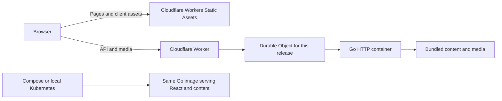

# Platform architecture

A visitor should be able to open a poem, browse a gallery, play a game, or share a project using a permanent URL. Billy publishes by reviewing and merging files in Git. Each release packages a complete snapshot of the site, so restoring a release also restores its content. The [roadmap](roadmap.md) starts with one poem and carries it through production.

## Repository baseline

The working tree has a project README and placeholders under `app/client/`, `app/server/`, `app/content/{writing,photography,drawings}/`, `deploy/kubernetes/`, `.github/workflows/`, and `.agents/skills/`. Application code, build manifests, deploy configuration, and workflows are still to be implemented. Keep the existing layout and add files as their milestones need them.

| Location | Proposed responsibility |
| --- | --- |
| `app/client/` | React, TypeScript, Vite, page routes, Markdown rendering, accessible galleries, and lazy-loaded browser games. |
| `app/content/` | Published text, metadata, and web-sized media. Add `projects/` and `games/` when those sections ship. |
| `app/server/` | Go HTTP service, content validation and indexing, health checks, static file serving, and the application Dockerfile. |
| `deploy/cloudflare/` | A small TypeScript Worker, Durable Object binding, and Wrangler configuration. |
| `deploy/compose.yaml` | Run the release image locally. During editing, run Vite and Go directly and proxy API and media requests through Vite. |
| `deploy/kubernetes/` | Local cluster manifests for the same application image. |
| `.github/workflows/` | Pull request checks, production release, and recovery workflow. |
| `.agents/skills/` | Repository-specific authoring or development skills when repeated tasks warrant one. |

## Request paths

**Pages and games.** Serve the Vite output through Workers Static Assets. A direct visit to `/writing/first-light` gets the React entry point. React loads the poem from the same origin. Reserve `/api/*` and `/media/*` with selective `run_worker_first` routing so even browser navigations there get Go's response and status code. Enable single-page application fallback for client routes. [Cloudflare asset routing](https://developers.cloudflare.com/workers/static-assets/binding/)

**Content requests.** Use the Durable Object-managed scheduling policy. The Worker selects a named object keyed by the release SHA. Its first request starts the configured image, waits for the Go listener on port 8080, and forwards the request. Requests to that release reuse the instance until its idle timeout. A new SHA gets a fresh instance, which avoids reusing a running process with yesterday's content. Start with one instance per active release, measure cold-start time, and check the Workers Paid plan and usage costs before launch. [Cloudflare Containers guide](https://developers.cloudflare.com/containers/get-started/) · [Container pricing](https://developers.cloudflare.com/containers/platform/pricing/)

**Portable image.** Build from the repository root with `app/server/Dockerfile` so the build can see all three app directories. Compile Go for Linux, build Vite with its lockfile, and copy the binary, published content, and client distribution into the runtime image. Export that same distribution for Worker assets. Produce a Linux AMD64 image for Cloudflare. In Compose and Kubernetes, Go owns the entire origin, dispatching API and media first, static files next, and HTML navigation requests to the React entry point. Index and validate the bundled content before reporting ready. [Cloudflare image requirements](https://developers.cloudflare.com/containers/get-started/)

## Publishing contract

The [Go backend specification](go-backend.md) defines the writing schema, HTTP responses, runtime behavior, and acceptance checks. The [React client specification](react-client.md) covers page routes, poem rendering, navigation, and how the client handles those responses.

Use one folder per published item. For example, `app/content/writing/first-light/index.md` supplies the slug `first-light`. YAML front matter supplies `title`, ISO publication date, and an optional summary. Preserve line breaks and stanza spacing when rendering poems. Galleries use an `index.json` with a title, date, and ordered images with relative filenames, alt text, and optional captions. Keep original-resolution artwork in the author's archive. Publish only the selected web versions.

| Request | Response |
| --- | --- |
| `GET /api/v1/writing` | JSON summaries with slug, title, date, and summary, newest first with slug as tie-breaker. |
| `GET /api/v1/writing/{slug}` | One summary plus its Markdown body. React renders it with embedded raw HTML disabled. |
| `GET /api/v1/{collection}` and `/{slug}` under that collection | Extend the list/detail pattern to photography, drawings, projects, and games. Gallery detail includes ordered media URLs. Game detail names a bundled client module. |
| `GET /media/{collection}/{slug}/{filename}` | Manifest-listed bytes with the correct MIME type. Use revalidation for filenames whose contents can change. |
| `GET /livez`, `GET /readyz`, `GET /api/v1/version` | Go process health, valid loaded content, and the running Git SHA respectively. Use the version endpoint for public deployment verification. |

Validate content with the same Go loader in CI and at startup. Reject duplicate slugs within a collection, invalid dates, missing media, paths outside an item's directory, and missing alt text. Return 404 for unknown items and media. A game entry references an explicitly registered client module so opening the portfolio never downloads a game's bundle. Project entries can link to a repository, a live demo, or a longer Markdown case study.

## Release and recovery

1. On a pull request, GitHub Actions installs locked dependencies, type-checks and builds React, tests and vets Go, validates all published content, and exercises the built image over HTTP. Content-only changes follow the same path. Production credentials belong to the deploy job.
2. On a push to `main`, check the exact merge SHA. Build the release, push the immutable application image to Cloudflare's registry, and save its digest. Deploy the Worker with the matching client distribution, image reference, and SHA through Wrangler. Use a production GitHub environment with a scoped Cloudflare API token and serialize deployments in one concurrency group. [GitHub environments](https://docs.github.com/en/actions/concepts/workflows-and-actions/deployment-environments) · [Workflow concurrency](https://docs.github.com/en/actions/concepts/workflows-and-actions/concurrency)
3. Fetch a deep link, a real content item, and the version endpoint with bounded retries for cold startup. Record the Git SHA, Worker version, image digest, and smoke-test result in the deployment summary. Keep a release bundle with Worker source/configuration, pinned toolchain metadata, and built client assets alongside the retained image.
4. If verification fails, mark the deployment failed. Provide a recovery workflow that takes a known-good release SHA, restores its bundle and retained image reference together, then repeats verification. Exercise recovery with an actual content edit. Keep API changes additive across adjacent releases because an open browser tab may still run the previous client.

## When the platform grows

**Media storage.** Track image size, deployment time, and first gallery load. If bundled photography dominates releases, upload content-addressed media to R2 before deployment and record each object key in the Git manifest. Keep the public media URLs and API shape stable. Retain objects referenced by recoverable releases.

**Minecraft.** Treat a world as a separate, long-running service with persistent storage and its own release cycle. For an initial Java Edition server, use a small VM with a persistent disk, a DNS-only play hostname, and a TCP game endpoint. Decide edition, player count, uptime budget, and who can join before provisioning. Enable an allowlist for a friends-only world and test a world backup by restoring it to a second instance. The website can publish join information independently. A later Kubernetes exercise can move a copy of the world to a single-replica StatefulSet with a persistent volume.
